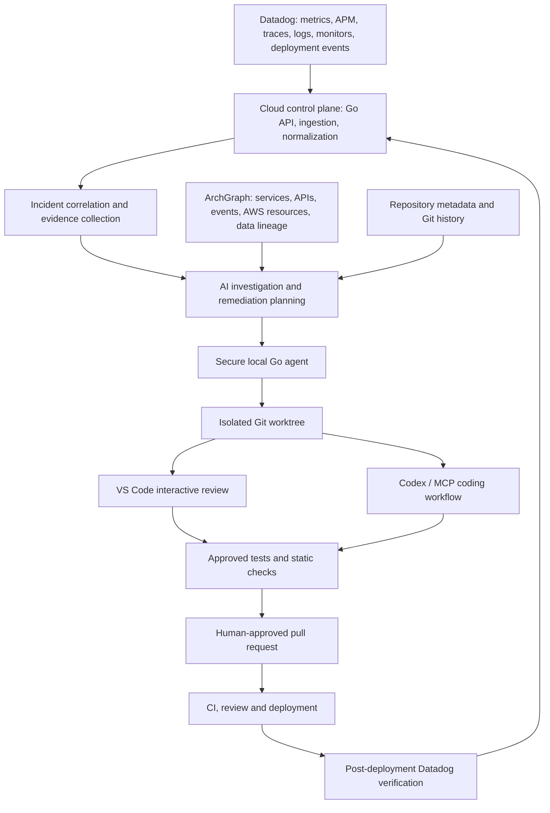
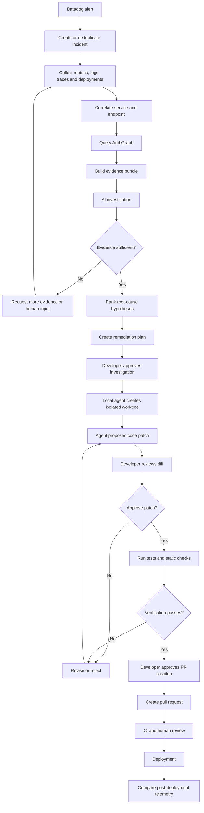

# IncidentPilot: Datadog-to-AI Interactive Remediation Platform

**Status:** Proposed architecture and implementation plan  
**Primary language:** Go  
**Developer interfaces:** VS Code and Codex  
**Architecture:** Hybrid cloud control plane + secure local agent  
**Related project:** [ArchGraph](https://github.com/PranitSakunde1/archgraph)

---

## 1. Product vision

IncidentPilot is an AI-assisted production incident investigation and code-remediation platform.

It connects production observability data from Datadog with source code, repository history, tests and architecture context. It investigates exceptions, latency regressions and other operational problems, proposes evidence-backed fixes, and lets an engineer review and validate changes interactively.

The system must not jump from an alert directly to a code edit. A metric is a symptom, not proof of root cause. High latency can originate from a database, upstream API, retries, thread contention, resource saturation or an inefficient code path.

**Core principle:** evidence-driven investigation first, human-approved remediation second.

## 2. Architectural principles

1. Separate production observability, AI investigation and local code execution.
2. Keep ArchGraph deterministic and AI-free during architecture discovery.
3. Use Datadog as runtime evidence and ArchGraph as structural architecture context.
4. Keep source-code access and code modification on the developer's machine.
5. Use isolated Git worktrees for remediation.
6. Give the agent narrow, typed tools instead of unrestricted shell access.
7. Require human approval for patch application, PR creation and other consequential actions.
8. Verify fixes with tests and post-deployment telemetry.
9. Preserve evidence, model/version metadata, approvals and audit history for reproducibility.
10. Treat logs, traces, source comments and repository content as untrusted input.

## 3. High-level architecture



### Component placement

| Component | Location | Responsibility |
|---|---|---|
| Datadog integration | Cloud control plane | Retrieve observability evidence |
| Incident control plane | Cloud or private deployment | Incident lifecycle and job orchestration |
| AI investigation | Cloud or enterprise model gateway | Hypothesis generation and remediation planning |
| ArchGraph | Local initially; optional shared graph later | Architecture context |
| Local agent | Developer machine / WSL2 | Source inspection, worktrees and tests |
| VS Code extension | Developer IDE | Interactive incident and diff review |
| Codex integration | Developer environment | Delegated coding and test tasks |

The cloud service must not initiate arbitrary shell commands on a developer's machine. The local agent establishes an authenticated outbound connection and accepts only authorized, typed jobs.

## 4. Datadog ingestion service

### Responsibilities

- Receive Datadog monitor notifications through webhooks.
- Query metrics around the incident time window.
- Retrieve related APM traces and spans.
- Retrieve relevant logs and exception stack traces.
- Retrieve deployment and change events.
- Identify service, environment, endpoint and affected version.

### Integration strategy

Use a combination of:

1. Webhooks for alert notification.
2. Datadog APIs for detailed evidence retrieval.
3. Bounded polling for incident updates when needed.

Do not continuously poll every metric. Start with alerts and retrieve surrounding evidence when an incident is created.

Use least-privilege Datadog credentials, secret management, bounded query windows and redaction before model submission.

## 5. Incident correlation engine

The correlation engine is more important than the LLM. It normalizes telemetry into a common incident model and correlates evidence across time, service, endpoint, deployment and trace identifiers.

Example:

```json
{
  "incident_id": "INC-1042",
  "service": "order-service",
  "environment": "production",
  "incident_type": "LATENCY_REGRESSION",
  "endpoint": "POST /orders",
  "started_at": "2026-11-08T10:30:00Z",
  "metrics": {
    "p95_latency_ms": 4800,
    "error_rate": 0.082
  },
  "deployment": {
    "version": "1.8.4",
    "previous_version": "1.8.3"
  }
}
```

The engine should ask:

- Did latency increase after a deployment?
- Did errors increase on the same endpoint?
- Are multiple services affected?
- Is there a database or AWS dependency in the slow trace?
- Are retries amplifying the original failure?
- Is this a recurring incident?

Preserve timestamps, trace IDs, service identity and source references throughout the workflow.

## 6. ArchGraph integration

ArchGraph supplies structural context that Datadog cannot provide by itself.

Example:

```text
order-service
    |
    | calls
    v
inventory-service
    |
    | publishes
    v
inventory-events (SNS)
    |
    | consumed by
    v
notification-service
    |
    | writes
    v
MongoDB: notifications
```

The investigation engine can query:

- Which repository owns a Datadog service?
- Which AWS resources does it use?
- Which internal wrapper calls SNS or SQS?
- Which downstream services consume its events?
- Which database collections or tables does it access?
- Which other services could be affected by a change?

ArchGraph remains deterministic and AI-free during discovery. IncidentPilot consumes its graph and evidence; it does not make the discovery process dependent on an LLM.

Service-name mapping between Datadog and `codeway.yaml` identities must be explicit and evidence-backed. Do not assume the names always match.

## 7. AI investigation engine

Do not start with a swarm of autonomous agents. Start with one orchestrator and bounded tools. The workflow should be controlled by an explicit state machine.

| Tool | Responsibility |
|---|---|
| `get_incident_context` | Retrieve normalized incident |
| `get_trace_details` | Inspect distributed trace |
| `search_logs` | Retrieve relevant logs |
| `query_metrics` | Query metric time series |
| `get_deployment_changes` | Retrieve deployment history |
| `archgraph_impact` | Query architecture relationships |
| `inspect_repository` | Inspect approved source paths |
| `search_code` | Search symbols and code |
| `run_tests` | Execute approved tests |
| `propose_patch` | Generate a reviewable patch |

Example investigation result:

```json
{
  "status": "HYPOTHESIS_READY",
  "hypotheses": [
    {
      "cause": "Database connection pool exhaustion",
      "confidence": "medium",
      "evidence": [
        "Repeated database timeout logs",
        "Increased connection wait duration",
        "Latency increase after deployment"
      ],
      "missing_evidence": [
        "Connection pool utilization during incident"
      ]
    }
  ],
  "recommended_next_action": "Inspect repository connection pool configuration"
}
```

Confidence must be tied to evidence, not emitted as an arbitrary percentage. Missing evidence must be explicit. The agent must be able to return `INSUFFICIENT_EVIDENCE`.

## 8. Local Go agent

The local agent is the security-sensitive component. It runs on the developer's machine or inside the developer's WSL2 environment.

### Modules

| Module | Responsibility |
|---|---|
| Agent supervisor | Registration, authentication and job lifecycle |
| Workspace manager | Discover permitted Git repositories |
| ArchGraph client | Load architecture graph and impact results |
| Source inspector | Search code, inspect symbols and configuration |
| Git manager | Create isolated worktrees and branches |
| Patch engine | Apply and revert proposed diffs |
| Test runner | Run approved test commands |
| Environment adapter | Interact with Docker, LocalStack and Testcontainers |
| Audit logger | Record actions and approvals |

### Git worktree isolation

Do not edit the developer's working branch directly.

```text
developer-workspace/
    order-service/
        main working tree

incidentpilot-worktrees/
    INC-1042/
        order-service/
            isolated remediation branch
```

This protects ongoing work, makes rollback straightforward and produces a clean diff.

### Permission model

| Action | Default |
|---|---|
| Read repository | Allowed |
| Search source | Allowed |
| Read Git history | Allowed |
| Inspect ArchGraph | Allowed |
| Generate proposed diff | Allowed |
| Apply diff to isolated worktree | Requires approval |
| Execute approved tests | Requires session authorization |
| Push branch | Explicit approval |
| Create PR | Explicit approval |
| Merge PR | Not allowed |
| Deploy production | Not allowed |

Never expose a generic `execute_shell` tool to the LLM. Use specific operations with schemas, path restrictions, timeouts, resource limits and audit records.

## 9. Interactive developer experience

### VS Code extension

Provide:

- Incident list and status.
- Evidence timeline.
- Trace and log references.
- Root-cause hypotheses.
- Source file navigation.
- Inline proposed changes.
- Test execution results.
- Approval and rejection controls.

Example incident view:

**INC-1042 · order-service**

- Environment: production
- Type: latency regression
- Evidence: database connection wait increased
- Correlation: latest deployment
- Missing evidence: connection pool utilization during incident

Agent explanation:

> The latency increase correlates with the latest deployment. Database connection waits increased during the same interval. I found a connection-pool configuration change, but have not established causation.

Suggested next action: inspect pool settings and compare connection utilization with the previous release.

### Codex integration

Use a local MCP server as the integration boundary. Suggested tools:

```text
incidentpilot.get_incident
incidentpilot.get_evidence
incidentpilot.get_affected_services
incidentpilot.inspect_repository
incidentpilot.get_archgraph_impact
incidentpilot.propose_patch
incidentpilot.get_test_plan
incidentpilot.run_approved_tests
incidentpilot.get_patch_status
```

Codex can use these tools to investigate and implement an approved task. The MCP server must not expose unrestricted shell execution.

## 10. Incident-to-fix workflow



A successful test run does not prove that the production incident is fixed. After deployment, compare affected metrics with the incident baseline.

## 11. Data architecture

Start with PostgreSQL. Do not introduce Kafka, Neo4j and multiple databases before workload measurements justify them.

| Data | Storage |
|---|---|
| Incidents and status | PostgreSQL |
| Evidence references and timestamps | PostgreSQL |
| Agent sessions and approvals | PostgreSQL |
| Audit trail | PostgreSQL, append-only records |
| Large trace/log evidence bundles | Encrypted object storage, optional |
| ArchGraph snapshots | Existing ArchGraph artifacts |
| Temporary patch files | Local worktree |
| Agent conversation state | Session-scoped storage with retention |

### Core entities

```text
Organization
  └── Workspace
       ├── Repository
       ├── Agent
       └── Incident
            ├── Evidence
            ├── Hypothesis
            ├── Investigation
            ├── RemediationPlan
            ├── Patch
            ├── TestExecution
            └── Approval
```

Each investigation should be reproducible from:

- Incident ID and time window.
- Datadog query parameters and references.
- Git commit SHA.
- ArchGraph snapshot version.
- Model and prompt version.
- Tool execution history.
- Patch hash.
- Test results.
- Human approvals.

## 12. API design

| Endpoint | Purpose |
|---|---|
| `POST /v1/webhooks/datadog` | Receive monitor events |
| `POST /v1/incidents` | Create incident manually |
| `GET /v1/incidents/{id}` | Retrieve incident details |
| `POST /v1/incidents/{id}/investigate` | Start investigation |
| `GET /v1/incidents/{id}/evidence` | Retrieve evidence |
| `GET /v1/incidents/{id}/hypotheses` | Retrieve root-cause hypotheses |
| `POST /v1/incidents/{id}/sessions` | Start local remediation session |
| `POST /v1/sessions/{id}/approve` | Approve a proposed action |
| `GET /v1/sessions/{id}/diff` | Retrieve proposed code diff |
| `POST /v1/sessions/{id}/tests` | Start approved tests |
| `POST /v1/sessions/{id}/pull-request` | Request PR creation |

Use asynchronous jobs for investigations and test execution. Return job IDs instead of holding HTTP requests open.

## 13. Technology choices

| Layer | Technology |
|---|---|
| Cloud API | Go + Chi or Gin |
| Local agent | Go |
| Datadog client | Official Datadog API client / REST adapters |
| Agent orchestration | Explicit state machine + tool-calling LLM |
| MCP server | Go |
| VS Code extension | TypeScript |
| Web dashboard | React + TypeScript |
| Database | PostgreSQL |
| Job queue | PostgreSQL-backed jobs initially |
| Cache | Redis only when needed |
| Local execution | WSL2 + Docker |
| Code intelligence | ArchGraph + Graphify |
| Testing | Go test, JUnit, Testcontainers, LocalStack |
| CI | GitHub Actions |

A Go state machine gives explicit transitions, retries, auditability and predictable failure handling. The LLM reasons within those boundaries; it does not own the workflow lifecycle.

## 14. Security and production safeguards

| Threat | Required control |
|---|---|
| Datadog credential leakage | Secret manager, least-privilege permissions |
| Sensitive log data | Redaction before model submission |
| Prompt injection in logs | Treat telemetry as untrusted data |
| Malicious repository content | Do not treat source comments or repository instructions as trusted agent instructions |
| Unauthorized code edits | Per-session approval and isolated worktrees |
| Arbitrary command execution | Allowlisted typed tools |
| Local machine exposure | Outbound-only agent connection |
| Cross-user data access | Workspace-scoped authorization |
| Model hallucinations | Evidence references and explicit unresolved hypotheses |
| Destructive patches | Diff review, tests and rollback |

Make model-provider selection configurable. Enterprise customers may not permit source code or telemetry to leave their network.

## 15. Implementation plan

### Phase 1: Datadog incident ingestion
- Datadog webhook receiver.
- Metrics, traces and log retrieval.
- Incident normalization.
- PostgreSQL persistence.
- Incident timeline API.

**Acceptance:** Given a Datadog monitor event, produce a normalized incident with linked evidence.

### Phase 2: Architecture correlation
- Integrate ArchGraph snapshots.
- Map Datadog service names to `codeway.yaml` identities and repositories.
- Resolve APIs, events, AWS resources and dependencies.
- Identify affected services.

**Acceptance:** An incident identifies its repository and relevant architecture dependencies with traceable evidence.

### Phase 3: Local Go agent
- Secure agent registration.
- Workspace discovery.
- Git worktree management.
- Read-only source inspection.
- Test execution through approved tools.

**Acceptance:** The agent can inspect a repository and run tests without modifying the developer's working tree.

### Phase 4: AI investigation
- Evidence bundle construction.
- Hypothesis generation.
- Root-cause ranking.
- Missing-evidence detection.
- Human-readable investigation report.

**Acceptance:** The agent produces an evidence-backed investigation and can explicitly report insufficient evidence.

### Phase 5: Interactive remediation
- Patch proposal.
- Isolated worktree changes.
- Interactive diff review.
- Test plan and execution.
- Revision and rejection workflow.

**Acceptance:** A developer can review, revise and validate a proposed fix without affecting their original branch.

### Phase 6: VS Code and Codex integration
- VS Code incident panel.
- MCP server.
- Codex tool integration.
- Session synchronization.

**Acceptance:** A developer can investigate and remediate through their normal coding environment.

### Phase 7: PR and production verification
- GitHub PR creation.
- CI result collection.
- Post-deployment metric comparison.
- Incident resolution and audit report.

**Acceptance:** A deployed fix can be evaluated against the original incident's telemetry baseline.

## 16. MVP scope

Start with one complete vertical slice:

- Datadog APM latency alert.
- One Go or Java Spring Boot service.
- One repository.
- Stack trace and trace-span correlation.
- ArchGraph service mapping.
- Local agent with Git worktree isolation.
- AI-generated patch.
- Developer approval.
- Unit tests and integration tests.

Not in the initial MVP:

- Autonomous production deployment.
- Automatic merging.
- Multi-agent swarm.
- Every programming language.
- Automatic remediation of infrastructure.
- Unrestricted shell access.

## 17. Initial repository structure

Create a separate repository named `incidentpilot`:

```text
incidentpilot/
├── cmd/
│   ├── control-plane/
│   ├── local-agent/
│   └── mcp-server/
├── internal/
│   ├── datadog/
│   ├── incident/
│   ├── correlation/
│   ├── evidence/
│   ├── investigation/
│   ├── remediation/
│   ├── workspace/
│   ├── gitworktree/
│   ├── testexecution/
│   ├── approvals/
│   └── security/
├── api/
│   └── openapi.yaml
├── ui/
│   ├── dashboard/
│   └── vscode-extension/
├── migrations/
├── deployments/
│   └── docker/
├── configs/
├── docs/
│   ├── architecture/
│   ├── security/
│   └── decisions/
├── fixtures/
├── go.mod
└── README.md
```

## 18. Key engineering risks and validation

| Risk | Why it matters | Validation |
|---|---|---|
| Service-to-repository mapping | Datadog service names may not match codeway identities | Test with actual service metadata |
| Trace-to-source mapping | A span may not identify an exact source location | Test Go and Java instrumentation |
| Root-cause accuracy | Correlation does not prove causation | Use known historical incidents |
| Agent patch quality | A syntactically valid patch may worsen production behavior | Replay incidents against fixtures |
| Test environment fidelity | LocalStack cannot reproduce every AWS behavior | Use integration and staging validation |
| Security | Logs and source can contain sensitive data | Redaction and adversarial tests |

Build a benchmark using historical incidents. Measure:

- Correct affected-service identification rate.
- Correct root-cause identification rate.
- Proposed patch acceptance rate.
- CI pass rate of accepted patches.
- Post-deployment improvement against incident metrics.
- Rate of investigations that incorrectly claim certainty.

Do not optimize for the number of patches generated. Optimize for **verified incident resolution**.

## 19. Deployment model decision

The recommended first prototype is:

**Cloud control plane + local agent**, provided the organization permits telemetry and selected source context to reach the chosen model provider.

The cloud service handles Datadog integration and AI orchestration. The local agent handles source inspection, test execution and code changes.

If source code or telemetry cannot leave the company network, use an entirely private deployment with an enterprise model gateway.

Fully local developer mode is useful for experimentation but is less suitable for team-wide incident coordination.

## 20. Final system boundary

- **Datadog** tells IncidentPilot what happened at runtime.
- **ArchGraph** tells it how the system is structurally connected.
- **The local agent** gives it a safe way to inspect, test and change code.
- **The AI investigation engine** correlates evidence and proposes hypotheses and fixes.
- **The developer** approves consequential changes.
- **CI and post-deployment telemetry** verify whether the fix actually worked.

These components together create an incident-to-remediation workflow. None of them alone is sufficient.